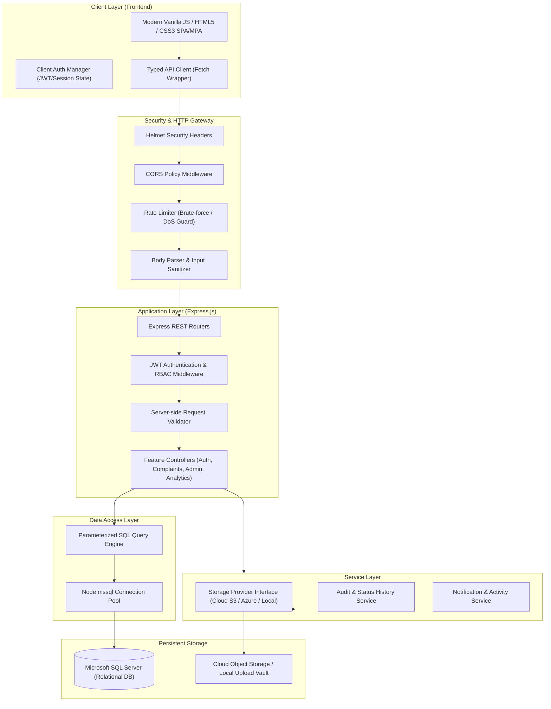
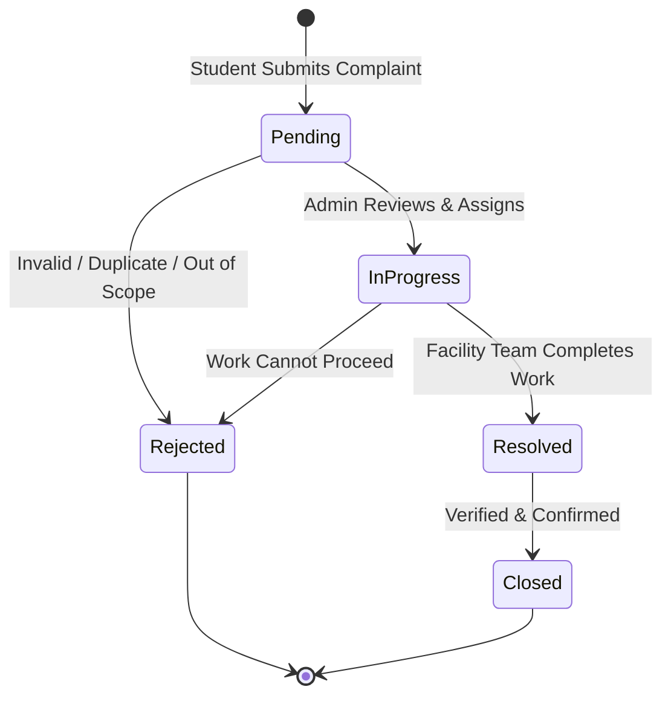

# CampusFix — System Architecture & Technical Design

## 1. System Overview

CampusFix is an enterprise-grade university issue reporting and resolution tracking web application. It connects students who observe facilities or infrastructure problems with campus administrative departments and facility teams.

The architecture is designed according to **Separation of Concerns (SoC)**, **Least Privilege**, and **Defense-in-Depth** security principles.



---

## 2. Technology Stack Rationale

| Layer | Technology | Rationale |
| :--- | :--- | :--- |
| **Frontend** | Vanilla HTML5, Modern CSS3, Modular JavaScript (ES6+) | Blazing fast initial load, zero framework build bloat, clean browser-native DOM management, highly maintainable for production hackathons and university systems. |
| **Backend** | Node.js (LTS), Express.js | Asynchronous event-driven I/O ideal for concurrent student/admin requests, robust middleware ecosystem, enterprise stability. |
| **Database** | Microsoft SQL Server (MSSQL), `mssql` driver | True relational ACID compliance, strong referential integrity, check constraints, indexed views, and high security for university enterprise ecosystems. |
| **Authentication** | JSON Web Tokens (JWT) + `bcryptjs` (salt rounds: 12) | Stateless, scalable authentication with server-side signature verification and strict role validation. |
| **Storage** | Pluggable Object Storage (Cloud S3 / Azure Blob / Local Provider) | Keeps heavy binary blobs out of MSSQL to preserve database performance, backups, and index efficiency. Only sanitized URLs and metadata are stored in the database. |

---

## 3. Core Entities & Lifecycle State Machine

### 3.1 Complaint Status Flow



### 3.2 Complaint Priorities

- **Low**: Minor cosmetic or non-disruptive defects (e.g., loose whiteboard marker holder).
- **Medium**: Annoying issues with temporary workarounds (e.g., flickering auxiliary light).
- **High**: Significant impairment of class or campus function (e.g., classroom projector failure, Wi-Fi outage in library).
- **Critical**: Safety, security, or health hazards (e.g., exposed high-voltage wiring, major pipe burst, security door lock broken).

---

## 4. Role-Based Access Control (RBAC) Matrix

| Resource / Action | Public / Guest | Student | Campus Admin |
| :--- | :---: | :---: | :---: |
| **Register / Login** | :white_check_mark: | :white_check_mark: | :white_check_mark: |
| **View Own Complaints** | :x: | :white_check_mark: | :white_check_mark: (All) |
| **View Other Student's Complaint** | :x: | :x: (Enforced 403 Forbidden) | :white_check_mark: |
| **Submit Complaint** | :x: | :white_check_mark: | :white_check_mark: |
| **Add Comment on Complaint** | :x: | :white_check_mark: (Own complaint only) | :white_check_mark: (Any complaint) |
| **Change Complaint Status** | :x: | :x: | :white_check_mark: |
| **Change Complaint Priority** | :x: | :x: | :white_check_mark: |
| **Assign Complaint to Department** | :x: | :x: | :white_check_mark: |
| **View Analytics & Reporting** | :x: | :x: | :white_check_mark: |
| **User Role Modification** | :x: | :x: | :x: (SuperAdmin/Migration only) |

---

## 5. Security & Threat Mitigation Architecture

1. **SQL Injection Defense**: Every single database interaction is executed through strict parameterized statements via the `mssql` driver (`request.input(name, type, value)`). Concatenated SQL is banned.
2. **Broken Object Level Authorization (BOLA / IDOR)**: When a student requests a complaint (`GET /api/complaints/:id`), the backend explicitly verifies `complaint.student_id === req.user.id` unless the user holds the `admin` role.
3. **Privilege Escalation Guard**: Role is extracted strictly from the verified JWT payload signed on the server. Registration endpoint hardcodes the role to `student` — admin accounts cannot be created via public registration.
4. **File Upload Hardening**:
   - File size restricted (max 5 MB).
   - Whitelist validation of MIME types (`image/jpeg`, `image/png`, `image/webp`).
   - File extension sanitized and randomized with cryptographic UUID to prevent directory traversal or remote executable upload (`.php`, `.exe`, `.sh`).
   - Binaries are stored in dedicated cloud object storage or isolated local storage; **never stored as BLOBs in MSSQL**.
5. **Rate Limiting & Brute-Force Guard**:
   - Authentication endpoints limited to 10 attempts per 15-minute window.
   - General API endpoints limited to 100 requests per 15-minute window per IP.
6. **Cross-Site Scripting (XSS)**:
   - Output encoding on the frontend.
   - Server-side input sanitization.
   - Strict `Content-Security-Policy` and HTTP security headers enabled via `helmet`.

---

## 6. Directory Structure Overview

```text
campusfix/
│
├── backend/
│   ├── config/              # Database connection, security constants, env validation
│   ├── controllers/         # Request handling logic (auth, complaints, comments, admin)
│   ├── middleware/          # Auth, RBAC, error handling, upload, rate-limiting
│   ├── models/              # Database queries, DAL, parameterized SQL
│   ├── routes/              # Express API route declarations
│   ├── services/            # Storage provider (cloud/local), audit logger
│   ├── utils/               # Sanitizers, response helpers, password hasher
│   ├── package.json         # Backend dependencies and run scripts
│   └── server.js            # Express application bootstrap & lifecycle
│
├── database/
│   ├── migrations/          # Versioned DDL scripts for MSSQL
│   ├── seeds/               # Initial categories, departments, admin accounts
│   └── scripts/             # Database initialization and maintenance scripts
│
├── frontend/
│   └── public/
│       ├── css/             # Modern CSS styles (main, dashboard, responsive grid)
│       ├── js/              # Modular vanilla JS (api, auth, student, admin, utils)
│       ├── assets/          # Static logos, icons, illustrations
│       ├── index.html       # Public landing page
│       ├── login.html       # Authentication: Login
│       ├── register.html    # Authentication: Register
│       ├── student-dashboard.html
│       ├── submit-complaint.html
│       ├── my-complaints.html
│       ├── complaint-details.html
│       ├── admin-dashboard.html
│       ├── admin-complaints.html
│       └── admin-analytics.html
│
├── docs/                    # Complete architectural & operational documentation
│   ├── ARCHITECTURE.md
│   ├── DATABASE_SCHEMA.md
│   ├── API_SPECIFICATION.md
│   ├── SECURITY.md
│   └── SETUP_GUIDE.md
│
├── .env.example             # Environment variable template
├── .gitignore               # Ignored files (secrets, uploads, node_modules)
└── README.md                # Project documentation and developer instructions
```
