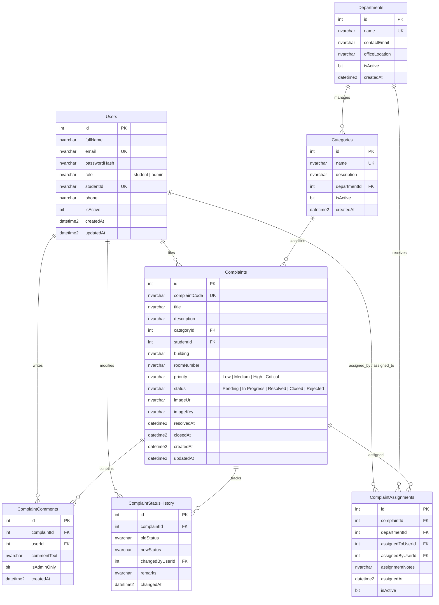

# CampusFix — Database Schema & Data Dictionary

## 1. Entity-Relationship Overview

CampusFix uses a normalized Microsoft SQL Server relational database designed for high data integrity, strict referential constraints, and fast query execution.



---

## 2. Table Specifications & Data Dictionary

### 2.1 Table: `Users`
Stores authentication credentials, profile data, and security roles.

| Column Name | Data Type | Nullable | Constraints & Defaults | Description |
| :--- | :--- | :---: | :--- | :--- |
| `id` | `INT IDENTITY(1,1)` | No | `PRIMARY KEY` | Unique surrogate primary key. |
| `fullName` | `NVARCHAR(150)` | No | | Full name of the user. |
| `email` | `NVARCHAR(255)` | No | `UNIQUE` | University email address (login credential). |
| `passwordHash` | `NVARCHAR(255)` | No | | Bcrypt password hash (cost factor >= 12). |
| `role` | `NVARCHAR(20)` | No | `CHECK (role IN ('student', 'admin'))` | System access role. |
| `studentId` | `NVARCHAR(50)` | Yes | `UNIQUE` | Official campus student roll number. |
| `phone` | `NVARCHAR(25)` | Yes | | Contact phone number. |
| `isActive` | `BIT` | No | `DEFAULT 1` | Soft account activation flag. |
| `createdAt` | `DATETIME2(3)` | No | `DEFAULT SYSUTCDATETIME()` | Account creation timestamp in UTC. |
| `updatedAt` | `DATETIME2(3)` | No | `DEFAULT SYSUTCDATETIME()` | Last update timestamp in UTC. |

---

### 2.2 Table: `Departments`
Administrative bodies responsible for specific campus facilities.

| Column Name | Data Type | Nullable | Constraints & Defaults | Description |
| :--- | :--- | :---: | :--- | :--- |
| `id` | `INT IDENTITY(1,1)` | No | `PRIMARY KEY` | Unique department identifier. |
| `name` | `NVARCHAR(100)` | No | `UNIQUE` | Name (e.g., IT Support, Physical Works). |
| `contactEmail` | `NVARCHAR(255)` | Yes | | Department notification email. |
| `officeLocation`| `NVARCHAR(150)` | Yes | | Campus office location. |
| `isActive` | `BIT` | No | `DEFAULT 1` | Active status flag. |
| `createdAt` | `DATETIME2(3)` | No | `DEFAULT SYSUTCDATETIME()` | Creation timestamp. |

---

### 2.3 Table: `Categories`
Problem categories mapped to handling departments.

| Column Name | Data Type | Nullable | Constraints & Defaults | Description |
| :--- | :--- | :---: | :--- | :--- |
| `id` | `INT IDENTITY(1,1)` | No | `PRIMARY KEY` | Unique category identifier. |
| `name` | `NVARCHAR(100)` | No | `UNIQUE` | Category title (e.g., Wi-Fi, Plumbing). |
| `description` | `NVARCHAR(300)` | Yes | | User-facing guidance for this category. |
| `departmentId` | `INT` | No | `FOREIGN KEY -> Departments(id)` | Responsible default department. |
| `isActive` | `BIT` | No | `DEFAULT 1` | Active status flag. |
| `createdAt` | `DATETIME2(3)` | No | `DEFAULT SYSUTCDATETIME()` | Creation timestamp. |

---

### 2.4 Table: `Complaints`
Core entity recording student facility grievances and current resolution states.

| Column Name | Data Type | Nullable | Constraints & Defaults | Description |
| :--- | :--- | :---: | :--- | :--- |
| `id` | `INT IDENTITY(1,1)` | No | `PRIMARY KEY` | Internal surrogate primary key. |
| `complaintCode` | `NVARCHAR(30)` | No | `UNIQUE` | Human-readable public code (e.g., `CMP-2026-0001`). |
| `title` | `NVARCHAR(200)` | No | | Short summary of the defect. |
| `description` | `NVARCHAR(MAX)` | No | | Detailed problem description. |
| `categoryId` | `INT` | No | `FOREIGN KEY -> Categories(id)` | Problem category. |
| `studentId` | `INT` | No | `FOREIGN KEY -> Users(id)` | User ID of the reporting student. |
| `building` | `NVARCHAR(120)` | No | | Academic/residential campus building. |
| `roomNumber` | `NVARCHAR(50)` | Yes | | Classroom / lab / room identifier. |
| `priority` | `NVARCHAR(20)` | No | `CHECK (priority IN ('Low','Medium','High','Critical'))` | Urgency indicator. |
| `status` | `NVARCHAR(20)` | No | `CHECK (status IN ('Pending','In Progress','Resolved','Closed','Rejected'))` | Resolution status. |
| `imageUrl` | `NVARCHAR(500)` | Yes | | Public URL or relative path to evidence image. |
| `imageKey` | `NVARCHAR(255)` | Yes | | Storage provider object key / unique filename. |
| `resolvedAt` | `DATETIME2(3)` | Yes | | Timestamp when marked Resolved. |
| `closedAt` | `DATETIME2(3)` | Yes | | Timestamp when marked Closed. |
| `createdAt` | `DATETIME2(3)` | No | `DEFAULT SYSUTCDATETIME()` | Timestamp when submitted. |
| `updatedAt` | `DATETIME2(3)` | No | `DEFAULT SYSUTCDATETIME()` | Timestamp of last modification. |

---

### 2.5 Table: `ComplaintComments`
Chronological discussion and updates between students and administrators.

| Column Name | Data Type | Nullable | Constraints & Defaults | Description |
| :--- | :--- | :---: | :--- | :--- |
| `id` | `INT IDENTITY(1,1)` | No | `PRIMARY KEY` | Comment identifier. |
| `complaintId` | `INT` | No | `FOREIGN KEY -> Complaints(id)` | Target complaint. |
| `userId` | `INT` | No | `FOREIGN KEY -> Users(id)` | Author of the comment. |
| `commentText` | `NVARCHAR(MAX)` | No | | Content of the message/update. |
| `isAdminOnly` | `BIT` | No | `DEFAULT 0` | If 1, internal note visible only to admins. |
| `createdAt` | `DATETIME2(3)` | No | `DEFAULT SYSUTCDATETIME()` | Timestamp of comment. |

---

### 2.6 Table: `ComplaintStatusHistory`
Immutable audit log recording every transition in complaint status.

| Column Name | Data Type | Nullable | Constraints & Defaults | Description |
| :--- | :--- | :---: | :--- | :--- |
| `id` | `INT IDENTITY(1,1)` | No | `PRIMARY KEY` | Audit record identifier. |
| `complaintId` | `INT` | No | `FOREIGN KEY -> Complaints(id)` | Affected complaint. |
| `oldStatus` | `NVARCHAR(20)` | Yes | | Previous status value. |
| `newStatus` | `NVARCHAR(20)` | No | | Newly assigned status value. |
| `changedByUserId` | `INT` | No | `FOREIGN KEY -> Users(id)` | Administrator or system making change. |
| `remarks` | `NVARCHAR(500)` | Yes | | Reason or update note for the change. |
| `changedAt` | `DATETIME2(3)` | No | `DEFAULT SYSUTCDATETIME()` | Timestamp of transition. |

---

### 2.7 Table: `ComplaintAssignments`
Tracks departmental and technician assignments.

| Column Name | Data Type | Nullable | Constraints & Defaults | Description |
| :--- | :--- | :---: | :--- | :--- |
| `id` | `INT IDENTITY(1,1)` | No | `PRIMARY KEY` | Assignment record identifier. |
| `complaintId` | `INT` | No | `FOREIGN KEY -> Complaints(id)` | Target complaint. |
| `departmentId` | `INT` | No | `FOREIGN KEY -> Departments(id)` | Assigned maintenance department. |
| `assignedToUserId` | `INT` | Yes | `FOREIGN KEY -> Users(id)` | Specific assigned technician (optional). |
| `assignedByUserId` | `INT` | No | `FOREIGN KEY -> Users(id)` | Admin issuing the assignment. |
| `assignmentNotes` | `NVARCHAR(500)`| Yes | | Specific task instructions. |
| `assignedAt` | `DATETIME2(3)` | No | `DEFAULT SYSUTCDATETIME()` | Assignment timestamp. |
| `isActive` | `BIT` | No | `DEFAULT 1` | 1 if this is the active assignment. |

---

## 3. Performance Indexes Strategy

To guarantee rapid queries under production load:

```sql
-- Search & Filtering on Complaints
CREATE NONCLUSTERED INDEX IX_Complaints_StudentId_Status ON Complaints(studentId, status) INCLUDE (title, priority, createdAt);
CREATE NONCLUSTERED INDEX IX_Complaints_Status_Priority ON Complaints(status, priority) INCLUDE (categoryId, building, createdAt);
CREATE NONCLUSTERED INDEX IX_Complaints_CategoryId ON Complaints(categoryId);
CREATE NONCLUSTERED INDEX IX_Complaints_CreatedAt ON Complaints(createdAt DESC);
CREATE UNIQUE NONCLUSTERED INDEX IX_Complaints_ComplaintCode ON Complaints(complaintCode);

-- Comments & Status History retrieval
CREATE NONCLUSTERED INDEX IX_ComplaintComments_ComplaintId ON ComplaintComments(complaintId, createdAt ASC);
CREATE NONCLUSTERED INDEX IX_ComplaintStatusHistory_ComplaintId ON ComplaintStatusHistory(complaintId, changedAt ASC);
CREATE NONCLUSTERED INDEX IX_ComplaintAssignments_ComplaintId ON ComplaintAssignments(complaintId) WHERE isActive = 1;
```
